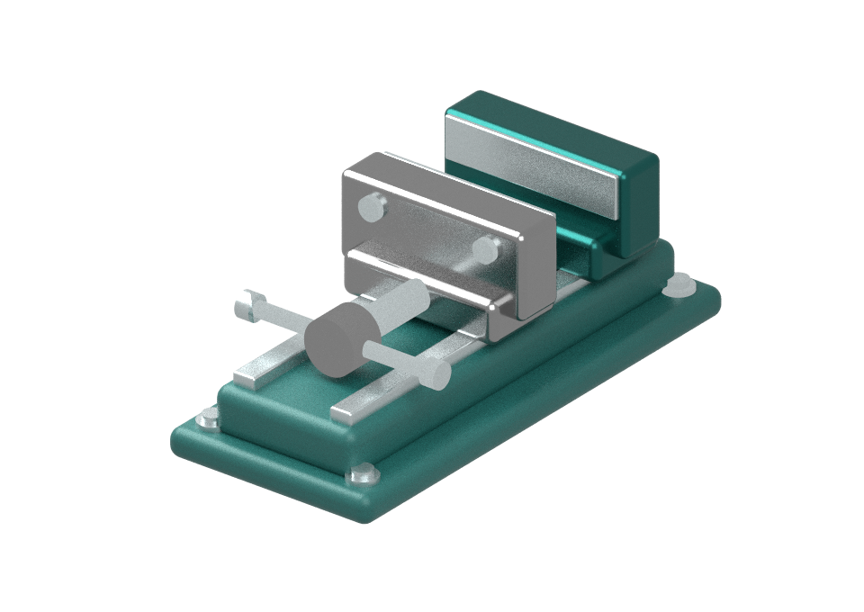
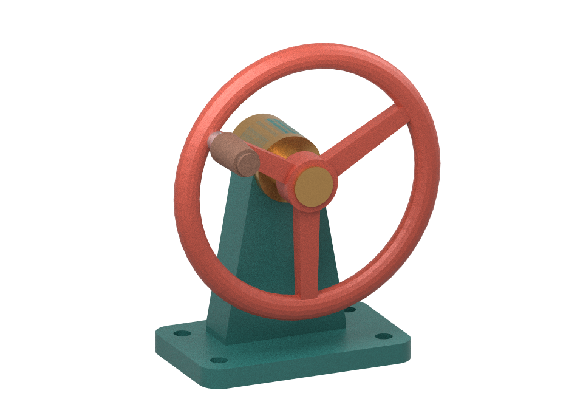

# an-shuttle

Shuttle connects an application view to a local workflow. The CAD painting example turns one saved revision of a small parametric bench vise into a transparent painting that can be opened independently in Krita.



[OpenRaster sample with four paint layers](examples/cad-paint/sample/vise.ora)

## CAD painting spool

Install Node 22+, Python 3.11 or 3.12, and Krita. From the repository root:

```sh
npm ci
npm run build
python3 -m venv .venv
. .venv/bin/activate
python -m pip install -r examples/cad-paint/requirements.txt
npm run studio
```

Visit http://127.0.0.1:4183. Adjust the jaw opening, camera and finishes. Click **保存并绘制**. The submitting CAD window freezes immediately. The server locks the saved revision before awaiting any work, broadcasts the lock to every connected CAD window and rejects concurrent or stale saves. A disconnected window stays disabled until it reconnects. Success or failure releases the lock.

The spool uses the provided camera and light. Omit the camera for the default three-quarter view, or omit the light for a random azimuth. Assign all four finishes to render offline. To ask a model for missing finishes, start local Ollama with a downloaded model that supports structured JSON. Set `OLLAMA_MODEL` to its name (default `gemma4:e4b`). Model failures are reported in the CAD interface.

Mitsuba path traces the saved geometry on the CPU. A separate visibility pass assigns visible pixels to the base, hardware, fixed jaw and moving jaw. Every delivery checks that the four layers composite byte-for-byte to the transparent PNG. The standalone ORA contains the resolved scene recipe. For finer editing, set `CUT_SPOOL_BIN` to a local cutting-spool executable before starting the studio. **送交切割 spool** passes the absolute ORA path as one argument. Exit zero acknowledges delivery. Handoff is optional and CAD stays editable while the cutter runs. Each save gets its own folder under `paintings/`. Shuttle requests that local Krita open the document and also exposes a download. Set `KRITA_BIN` or `PYTHON_BIN` to override executable paths.

## Swap the source CAD

The second example is a three-spoke handwheel designed in OpenSCAD. It has five part groups and one editable shaft angle. Launch the same studio with the model directory:

```sh
npm run studio -- examples/cad-paint/handwheel
```

Set `PORT=4184` to run it alongside the vise. The browser owns the edit lock in conjunction with the studio server. OpenSCAD supplies the assembly geometry offline. The native OpenSCAD editor is outside this lock.



[Five-layer handwheel ORA](examples/cad-paint/sample/handwheel.ora)

- Edit `model.scad` for the solid geometry and the named part groups.
- Edit `model.json` for part IDs, mask colors, supplied finishes, framing and the revolute joint. The neutral-angle meshes use the same world coordinates and pivot as OpenSCAD.
- Rebuild `meshes.json` after geometry or part-ID changes with `python3 examples/cad-paint/export-scad.py examples/cad-paint/handwheel`. OpenSCAD is needed only for this export. Set `OPENSCAD_BIN` if the executable has a different path.

The two demos share capture, locking, material negotiation, scene rendering, ORA delivery and cutting-spool handoff. Additional triangle-mesh assemblies with a single axis-aligned revolute joint can use the directory interface. A different native editor or another joint type needs its own integration.

## Workspaces

| Workspace | Responsibility |
| --- | --- |
| `packages/view` | View binding, revision checks and serialized edits |
| `packages/cad` | CAD snapshot validation, part identifiers and vise geometry |
| `packages/krita` | Packaging paint layers and opening a local document |
| `examples/cad-paint` | Web CAD, lock owner, material negotiation and rendering spool |
| `examples/plate` | Minimal plate editor demonstrating a bound view |

## Plate view

After building, run `npm start` and open http://127.0.0.1:4182. Open two plate views, bind one, then choose **Show saved check**. Only the selected view highlights. Refreshing a view requires a fresh binding.

An edit clears the mark and invalidates its target immediately. The first save starts immediately and edits made in flight coalesce. The helper also accepts an explicit trailing delay. A matching save acknowledgement makes the latest generation available. The action rechecks its target immediately before changing the UI.

Run `npm test` with the rendering dependencies installed. With Google Chrome installed, `npm run test:browser` checks view targeting, multi-tab locks and recovery. Both suites use the same incremental TypeScript build.
