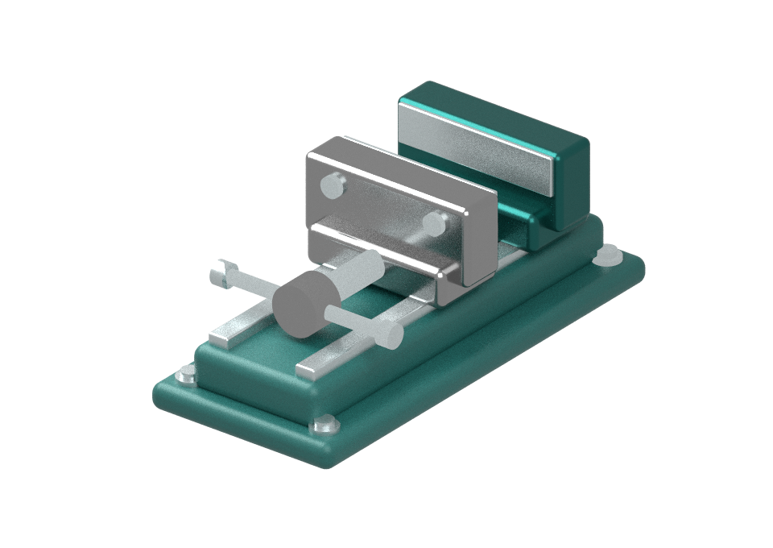
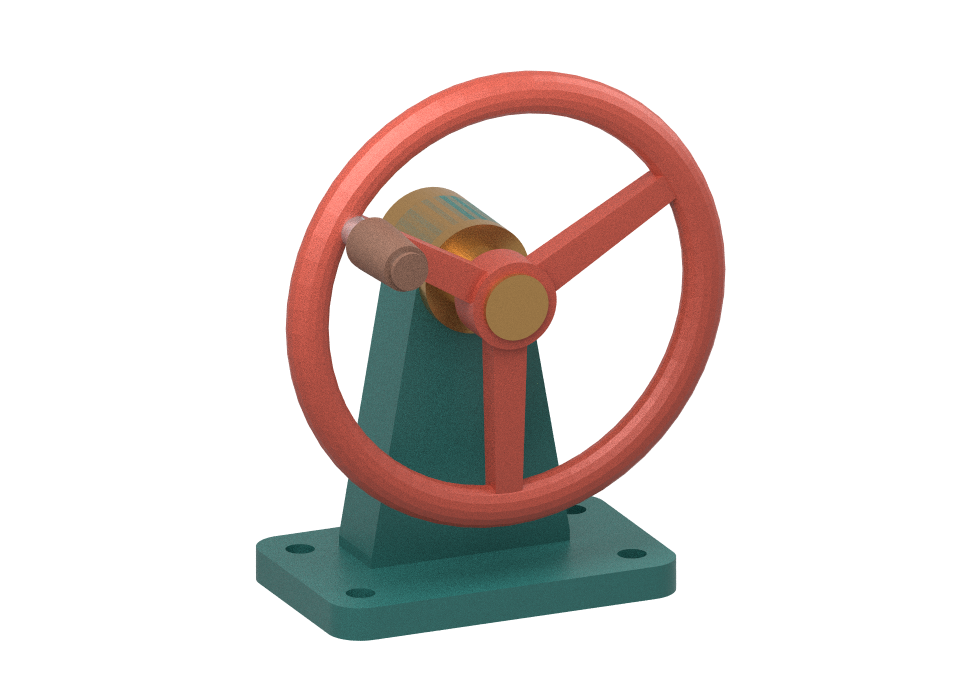

# an-shuttle

[English](README.md) · 中文译文，以英文为准。

Shuttle 将应用程序视图连接到本地工作流。CAD 绘画示例把小型参数化台钳的一次保存转换成透明绘画素材，可在 Krita 中独立打开。



[包含四个绘画图层的 OpenRaster 示例](examples/cad-paint/sample/vise.ora)

## CAD 绘画 spool

要使用受管保存，请在 macOS 上安装 Node 22+、Python 3.11 或 3.12，以及 Krita。将固定的 [an-loom CLI](https://github.com/lazyalexander/an-loom/tree/9089b0283cc9077f51447e38b32f553049948d98) 和 [an-agent-host CLI](https://github.com/lazyalexander/an-agent/tree/7c5fa1f2c70d36fbdd8b4054ca9384dfa9174f75) 放在 PATH 中，或者使用 `AN_LOOM_BIN` 和 `AN_AGENT_HOST_BIN` 选择二进制文件。使用发布版本（在相应仓库中的 `cargo build --release --locked --bin an-loom` 和 `cargo build --release --locked --bin an-agent-host`）因为宿主会计算所选 Python 环境的哈希。从干净的检出开始，选择一个专用运行时：

```sh
npm ci
npm run build
python3 -m venv --without-pip .venv
python3 -m pip --python .venv install --only-binary=:all: --no-compile -r examples/cad-paint/requirements.txt
.venv/bin/python -B examples/cad-paint/prepare-runtime.py "$(node -p "require.resolve('@an-loom/cad-paint-spool/manifest')")" .venv/paint-runtime.json
export CAD_PAINT_RUNTIME="$PWD/.venv/paint-runtime.json"
npm run studio
```

访问 http://127.0.0.1:4183 ，调整钳口开度、相机和表面材质。点击 **保存并绘制**。提交保存的 CAD 窗口会立即锁定。服务器在等待任何工作之前锁定保存的修订版本，将锁定广播到所有连接的CAD窗口，并拒绝并发或过时的保存。断开连接的窗口将保持禁用状态，直到重新连接。绘画工作台在成功时发布两件已验收的产物，并在等待Krita打开之前释放CAD锁。确认任务已失败终止后解锁，页面不提供下载。如果等待的CLI丢失了结果，工作室将保持锁并检查同一次受监管的执行是否已经终止。

spool使用提供的相机和灯光。省略相机时使用默认的四分之三视角，省略灯光时随机选择照明方位角。为四个部件全部指定材质即可离线渲染。若要向模型请求缺失的表面处理，启动本地Ollama并使用支持结构化JSON的下载模型。将 `OLLAMA_MODEL` 设置为其名称（默认 `qwen3:8b`），并可选地将 `OLLAMA_HOST` 设置为其基础URL（默认 `http://127.0.0.1:11434`）。模型失败会在CAD界面中报告。

Mitsuba在CPU上对保存的几何体进行路径追踪。一个单独的可见性通道将可见像素分配给底座、五金件、固定钳口和活动钳口。每次交付都会检查四个图层的合成结果是否与透明 PNG 逐字节一致。独立的 ORA 包含材质和照明等已经确定的场景参数。如需更精细的编辑，请在启动工作室前将 `CUT_SPOOL_BIN` 设置为本地切割spool可执行文件。**送交切割 spool** 将绝对ORA路径作为单个参数传递。退出码为零表示接收成功。交接是可选的，CAD在切割器运行期间仍可编辑。每次保存都会在 `paintings/` 下创建自己的文件夹。Shuttle请求本地Krita打开文档，同时提供下载。将 `KRITA_BIN` 设置以选择本地绘画应用。

对于Linux或macOS上的独立渲染器，请在虚拟环境中安装相同的Python依赖项，激活它并显式运行 `npm run studio -- --standalone`。此模式直接执行Python入口点，并支持 `PYTHON_BIN`。普通保存始终使用管理的配置文件。

## 更换源CAD

第二个示例是一个三辐手轮，使用OpenSCAD设计。它有五个部件组和一个可编辑的轴角。使用模型目录启动同一个绘画工作台：

```sh
npm run studio -- examples/cad-paint/handwheel
```

若需和台钳示例同时运行，请设置 `PORT=4184`。浏览器与 studio 服务器共同拥有编辑锁。OpenSCAD 离线提供装配体几何。原生的 OpenSCAD 编辑器在此锁之外。



[五层手轮 ORA](examples/cad-paint/sample/handwheel.ora)

- 编辑 `model.scad` 以处理实体几何体和命名的部分组。
- 编辑 `model.json` 以处理部分 ID、遮罩颜色、提供的表面处理、边框以及旋转关节。中性角网格使用与 OpenSCAD 相同的世界坐标和旋转中心。
- 使用独立的创作环境，以避免导入 CAD 工具使所选绘画运行时的站点哈希失效：

```sh
python3 -m venv .venv-authoring
.venv-authoring/bin/python -m pip install -r examples/cad-paint/authoring-requirements.txt
.venv-authoring/bin/python examples/cad-paint/export-scad.py examples/cad-paint/handwheel
```

Trimesh拥有STL解码功能；几何处理被禁用，适配器保留零件名称、三角形顺序和五位小数坐标。仅需OpenSCAD用于此导出。如果其可执行文件路径不同，请设置`OPENSCAD_BIN`。在几何或零件ID更改后重新构建`meshes.json`。将`.venv-authoring`与哈希绑定的绘画环境分开。

两个演示共享捕获、锁定、材质协商、场景渲染、ORA交付和切割 spool 交接。带有单个轴对齐旋转关节的额外三角形网格装配可以使用目录接口。不同的原生编辑器或另一种关节类型需要其自身的集成。

## Loom包和Shuttle边界

CAD保存携带一个意图、一个固定文档修订版本、其观察结果以及通过`packages/cad/shuttle.ts`的可选操作方向。工作室持有CAD锁，并将该消息传递给领域代理。它为模型提供缺失的零件标签、现有的表面处理和方向。具有完整材质时，可以直接启动基线。

[Loom中的CAD绘画参考包](https://github.com/lazyalexander/an-loom/tree/821176910ceba06fa5fa0b6036d7f4d09291c2d1/examples/cad-paint)拥有领域源代码。`npm ci`从一个不可变提交URL安装v0.1.0，并验证其分发与`package-lock.json`中的完整性。两个CAD模型都使用此包。macOS接受导出的正是其包含的精确Loom存档。其代理为此次尝试提出一个私有`kit/appearance.py`。其只读silk拥有渲染、PNG/ORA形状和像素重建。生成的文档记录输入和所选kit的哈希值。对于每个管理的保存，工作室将固定存档导出到一个新的本地实例中。仅在材质缺失时才应用外观kit。宿主监督一次运行，接受输出并检查其目录中的两个固定修订版本。工作室在`accepted.json`中记录此库存，并在两个检查出后使ORA可见。每次尝试都保留其`saved.json`、`request.json`和实例以供检查。对于丢失的监督响应，`an-agent-host spool-status <attempt>/instance paint`检查相同的尝试。macOS接受通过两个浏览器标签执行此路径。进一步的零件切割是新的尝试，具有其自己的输入。

[内容标签合同](https://github.com/lazyalexander/an-loom/blob/main/docs/spool-code.md)
为所有选定的spool发布文件silk进行标签，包括历史`kit/`路径。
批准的工作副本和生成的工作属于kit。选定的技能和代理
指令保持受保护；标签更改不会授权执行。接受的
绘画属于保留的成果保管，而不是可丢弃的kit草稿。当前
宿主配置文件仍限制可编辑的插槽；这不会启用任意的自我编辑。

## 工作区

| 工作区 | 责任 |
| --- | --- |
| `packages/view` | 视图绑定、修订检查和串行编辑 |
| `packages/cad` | CAD 快照验证、部件标识符和示例几何 |
| `packages/krita` | 打开本地文档；领域格式生成仍保留在固定的Loomspool中 |
| `examples/cad-paint` | Web CAD、锁拥有者和固定的绘画spool客户端 |
| `examples/plate` | 一个最小的板编辑器，演示绑定视图 |

## 板视图

构建后，运行 `npm start` 并访问 http://127.0.0.1:4182 。打开两个板视图，绑定其中一个，然后点击 **Show saved check**。只有选定的视图会高亮。刷新后需要重新绑定。

编辑会立即清除标记并使其目标失效。第一次保存会立即开始，保存执行期间的编辑会合并。助手还接受一个显式的尾随延迟。匹配的保存确认会使最新的生成版本可用。操作在更改用户界面之前会立即重新检查其目标。

运行 `npm test` 并安装渲染依赖。安装了 Google Chrome 之后，`npm run test:browser` 会检查视图目标、多标签锁定和恢复。两个kit都使用相同的增量 TypeScript 构建。

## 管理的 CAD 和原生 Krita 接受

[可移植的验收记录](examples/cad-paint/acceptance/macos.json) 记录实际的双标签保存，一个本地 Gemma 材料建议，宿主取消，固定输出交付和 Krita 导入/保存两个绘图。导入的 KRA 文件保留所有四个/五个可编辑的绘画图层，并且精确地再现接受的 PNG 像素。提供者只能看到域描述、操作方向、提供的完成和缺失部分标签。所选kit不能替换受保护的渲染器。错误来源和过期保存在提交前会被拒绝。

使用 `.github/workflows/loom-spool.yml` 进行新鲜环境的配方。它会分别运行 `managed.test.js`，并将 `CAD_PAINT_FIXTURE` 设置为 `vise`、`handwheel`、`incomplete` 和 `cancelled`。取消操作会等待实际的渲染器活动，调用现有的宿主监督者，并需要任务终止证据；两个 CAD 标签无需下载即可解锁。最终的 Python 验证器会检查目录哈希、受保护源更新拒绝、进程回收和失败/取消接受拒绝。CI 在一个新鲜的本地端口上使用一个确定性的模型测试样例。

对于一个显式的实际模型运行，设置 `CAD_PAINT_REAL_MODEL=1` 用于手轮测试样例；其本地观察代理会将一个请求转发到所选的 `OLLAMA_HOST`。`CAD_PAINT_REAL_KRITA=1` 也会请求原生文档启动。保持生成的请求和交换日志私密。完整原生读回：

```sh
python3 -B .github/scripts/qualify-painted-spool.py verify "$CAD_PAINT_TEST_OUTPUT" \
  --krita /selected/krita
```

这调用 Krita 的 [文档中记录的导出命令](https://docs.krita.org/en/reference_manual/linux_command_line.html)，使用一个独立的资源目录，然后检查 KRA 图层和合并后的像素。它验证原生文件的导入/导出功能，而不是 GUI 刷子编辑。仅有启动请求是不够的。之前的 `packPainting` 兼容性条目已弃用；安装的域 spool 已经生成并验证了 ORA，因此 Krita 桥接不再携带 Python 包装胶水或域包的 peer 依赖。

### 重用当前 CAD 会话中已接受的材料

对于受管保存，将 `CAD_MATERIAL_READER` 设置为
`examples/cad-material-evidence/read_material.py` 在一个已审查的 an-loom
检出中。在成功保存后，编辑器会提供上一次接受版本的手轮握把
或夹具移动颚。

选择显示的版本会直接读取已验收 ORA。历史查证改由 **Codex CLI 0.166.0** 承担 agent 过程：Codex 调用唯一获准的材质读取工具，再返回结构化采纳决定。Shuttle 核验图纸、部件、确切修订和本次证据编号，将宿主原始证据交给渲染。拒绝、越权、重复读取或取消均不能进入渲染。

通过 `npm install -g @openai/codex@0.166.0` 安装固定版本，并执行 `codex login` 登录。`CAD_MATERIAL_CODEX_BIN` 可指定操作员审查的可执行文件，`CAD_MATERIAL_CODEX_MODEL` 可指定该登录可用的模型。适配器忽略环境中的用户配置、执行规则、项目说明、插件与钩子，在空临时目录中运行，关闭 shell、图片读取和原生子 agent，不授予目录外的文件权限或任何写权限。只有短时、带随机令牌的 MCP 端点能解析选定材质。MCP 协议由上游 SDK 处理，agent 循环由 Codex 处理。

在提交任何 Codex 任务前，匹配的 Loom 读取器须通过 `--check-delegation` 核准 `codex-selected-material`。读取器旁的 `delegation.json` 必须允许该模式。允许发送所选图纸、部件、已验收修订、产物修订和材质元数据，以及 Shuttle 新生成的本次证据编号。源文件路径、ORA、网格、其他部件、文档世代和原生记录均留在本地。界面会说明这项披露。仅限本地的声明会在 Codex 启动前拒绝；解析产物时还会再次核验声明。

历史查证可在界面取消。取消会撤销工具读取、终止 CLI，并在本地进程关闭后结束本次保存；迟到结果不能进入渲染。私有 `material-codex/receipt.json` 记录提交与 CLI 完成状态；只有提交而无完成记录时须检查，不自动重放。一个保存目录只能提交一次。原生渲染结算和已验收产物保管仍由宿主负责。

旧的 `an-agent-host model` 请求/采纳双阶段驱动、模型配置和历史查证 Ollama 代理已删除，不保留回退通路。Ollama 仍可用于“补全缺失材质”这一独立任务；已提供材质或复用已验收材质时无需启动 Ollama。

配置宿主、运行时和匹配的读取器后，每次验收使用新的 `CAD_PAINT_TEST_OUTPUT`：

```sh
npm run build
npm run test:codex
CAD_PAINT_FIXTURE=handwheel CAD_PAINT_REAL_CODEX=1 \
  node --test examples/cad-paint/dist/managed.test.js
```

`test:codex` 使用真实固定版本的 Codex 二进制和本地 Responses 协议样本，无需登录；它验证 MCP 发现、采纳、越权拒绝与禁止重放。CI 对两种图纸和取消流程使用相同的真实二进制及协议样本，样本输出不代表模型质量。`CAD_PAINT_REAL_CODEX=1` 才使用已登录的提供方完成历史查证；`CAD_PAINT_REAL_MODEL=1` 独立控制缺失材质的真实 Ollama 调用。真实验收须区分这些设置，并另外核对 PNG/ORA 清单与实际 Krita 导入。

已验证范围与限制见[验收记录](examples/cad-paint/qualification-codex-material.md)。
