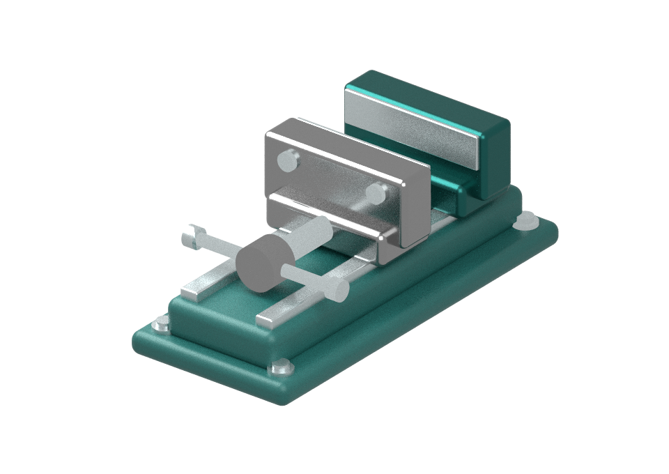
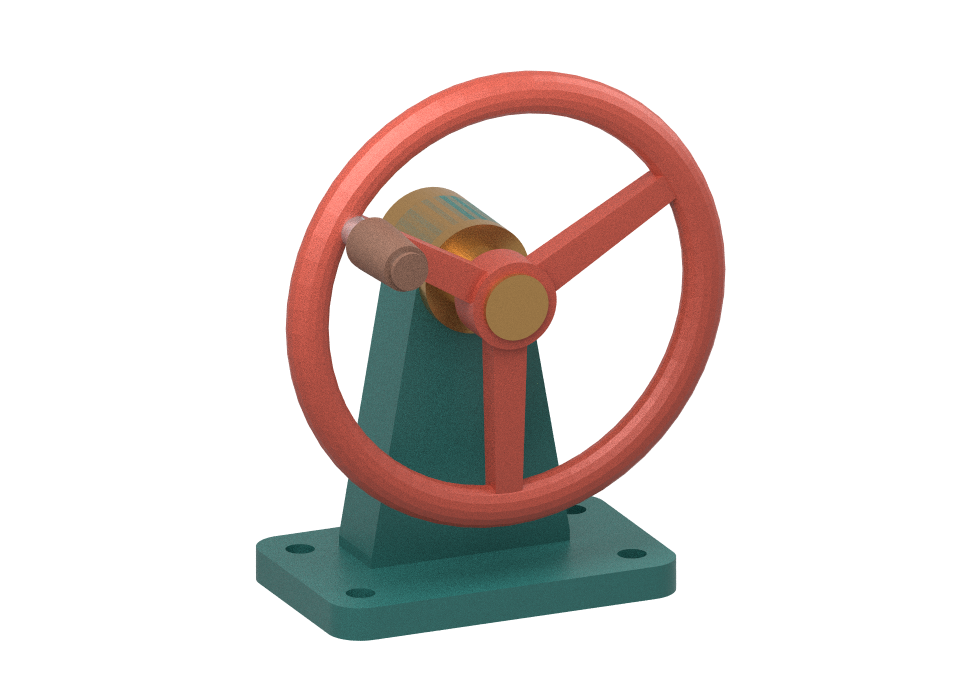

# an-shuttle

English · [简体中文](cad-paint.zh-CN.md)

Shuttle connects an application view to a local workflow. The CAD painting example turns one saved revision of a small parametric bench vise into a transparent painting that can be opened independently in Krita.



[OpenRaster sample with four paint layers](../examples/cad-paint/sample/vise.ora)

## CAD painting spool

For a managed save, install Node 22+, Python 3.11 or 3.12, and Krita on macOS. Put the pinned [an-loom CLI](https://github.com/lazyalexander/an-loom/tree/9089b0283cc9077f51447e38b32f553049948d98) and [an-agent-host CLI](https://github.com/lazyalexander/an-agent/tree/3a3666cc9994f6add1c453f2684285012caa44cf) on PATH, or select the binaries with `AN_LOOM_BIN` and `AN_AGENT_HOST_BIN`. Use release builds (`cargo build --release --locked --bin an-loom` and `cargo build --release --locked --bin an-agent-host` in the respective repositories) because the host hashes the selected Python environment. From a clean checkout, select a dedicated runtime once:

```sh
npm ci
npm run build
python3 -m venv --without-pip .venv
python3 -m pip --python .venv install --only-binary=:all: --no-compile -r examples/cad-paint/requirements.txt
.venv/bin/python -B examples/cad-paint/prepare-runtime.py "$(node -p "require.resolve('@an-loom/cad-paint-spool/manifest')")" .venv/paint-runtime.json
export CAD_PAINT_RUNTIME="$PWD/.venv/paint-runtime.json"
npm run studio
```

Visit http://127.0.0.1:4183. Adjust the jaw opening, camera and finishes. Click **保存并绘制**. The submitting CAD window freezes immediately. The server locks the saved revision before awaiting any work, broadcasts the lock to every connected CAD window and rejects concurrent or stale saves. A disconnected window stays disabled until it reconnects. The studio publishes both accepted artifacts on success and releases the CAD lock before waiting for Krita to open. A confirmed terminal failure releases the lock with no download. If the waiting CLI loses its result, the studio keeps the lock and checks the same supervised run for termination.

The spool uses the provided camera and light. Omit the camera for the default three-quarter view, or omit the light for a random azimuth. Supplying all finishes renders offline. Missing finishes use the same qualified Codex CLI as historical verification: install `@openai/codex@0.166.0` and sign in with `codex login`. Select a reviewed executable with `CAD_MATERIAL_CODEX_BIN` and an available model with `CAD_MATERIAL_CODEX_MODEL`. No local model server, downloaded weights or Ollama configuration are needed. Model failures fail the save.

Mitsuba path traces the saved geometry on the CPU. A separate visibility pass assigns visible pixels to the base, hardware, fixed jaw and moving jaw. Every delivery checks that the four layers composite byte-for-byte to the transparent PNG. The standalone ORA contains the resolved scene recipe. For finer editing, set `CUT_SPOOL_BIN` to a local cutting-spool executable before starting the studio. **送交切割 spool** passes the absolute ORA path as one argument. Exit zero acknowledges delivery. Handoff is optional and CAD stays editable while the cutter runs. Each save gets its own folder under `paintings/`. Shuttle requests that local Krita open the document and also exposes a download. Set `KRITA_BIN` to select the local painting app.

For the standalone renderer on Linux or macOS, install the same Python requirements in a virtual environment, activate it and explicitly run `npm run studio -- --standalone`. This mode executes the Python entry directly and supports `PYTHON_BIN`. An ordinary save always uses the managed profile.

## Swap the source CAD

The second example is a three-spoke handwheel designed in OpenSCAD. It has five part groups and one editable shaft angle. Launch the same studio with the model directory:

```sh
npm run studio -- examples/cad-paint/handwheel
```

Set `PORT=4184` to run it alongside the vise. The browser owns the edit lock in conjunction with the studio server. OpenSCAD supplies the assembly geometry offline. The native OpenSCAD editor is outside this lock.



[Five-layer handwheel ORA](../examples/cad-paint/sample/handwheel.ora)

- Edit `model.scad` for the solid geometry and the named part groups.
- Edit `model.json` for part IDs, mask colors, supplied finishes, framing and the revolute joint. The neutral-angle meshes use the same world coordinates and pivot as OpenSCAD.
- Use a separate authoring environment so importing CAD tools does not invalidate the selected painting runtime's site hash:

```sh
python3 -m venv .venv-authoring
.venv-authoring/bin/python -m pip install -r examples/cad-paint/authoring-requirements.txt
.venv-authoring/bin/python examples/cad-paint/export-scad.py examples/cad-paint/handwheel
```

Trimesh owns STL decoding; geometry processing is disabled, and the adapter preserves part names, triangle order and five-decimal coordinates. OpenSCAD is needed only for this export. Set `OPENSCAD_BIN` if its executable has a different path. Rebuild `meshes.json` after geometry or part-ID changes. Keep `.venv-authoring` separate from the hash-bound painting environment.

The two demos share capture, locking, material negotiation, scene rendering, ORA delivery and cutting-spool handoff. Additional triangle-mesh assemblies with a single axis-aligned revolute joint can use the directory interface. A different native editor or another joint type needs its own integration.

## Spool package and Shuttle boundary

A CAD save carries an intent, a fixed document revision, its observations and optional operator direction through `packages/cad/shuttle.ts`. The studio holds the CAD lock and hands that message to the domain agent. It gives the model the missing part labels, the existing finishes and the direction. With complete materials it can start the baseline directly.

The [mature CAD painting package in an-spool](https://github.com/lazyalexander/an-spool/tree/a9bffc3f757f7c82c4dcbca78d063f317d38a27d/spools/cad-paint) owns the domain source. `npm ci` installs v0.1.0 from an immutable commit URL and verifies the distribution against the integrity in `package-lock.json`. Both CAD models use this package. The macOS acceptance exports the exact Loom archive included in it. Its agent proposes a private `kit/appearance.py` for this attempt. Its read-only silk owns the render, PNG/ORA shape and pixel reconstruction. The resulting document records the input and selected kit digests. For each managed save, the studio exports the pinned archive into a fresh native instance. It applies an appearance kit only when materials are missing. The host supervises one run, accepts the outputs and checks out the two fixed revisions in its catalog. The studio records this inventory in `accepted.json` and makes the ORA visible after both checkouts. Each attempt retains its `saved.json`, `request.json` and instance for inspection. For a lost supervisor response, `an-agent-host spool-status <attempt>/instance paint` inspects the same attempt. The macOS acceptance exercises this path through two browser tabs. Further part cutting is a new attempt with its own input.

The [content label contract](https://github.com/lazyalexander/an-loom/blob/main/docs/spool-code.md)
labels all selected spool release files silk, including historical `kit/` paths.
Approved working copies and generated work are kit. Selected skill and agent
instructions stay protected; label changes do not authorize execution. Accepted
paintings belong to retained artifact custody, not disposable kit scratch. Current
host profiles still limit editable slots; this does not enable arbitrary self-editing.

## Workspaces

| Workspace | Responsibility |
| --- | --- |
| `packages/view` | View binding, revision checks and serialized edits |
| `packages/cad` | CAD snapshot validation, part identifiers and vise geometry |
| `packages/krita` | Opening a local document; domain format generation stays in the pinned Loom spool |
| `examples/cad-paint` | Web CAD, lock owner and pinned painting-spool client |
| `examples/plate` | Minimal plate editor demonstrating a bound view |

## Plate view

After building, run `npm start` and open http://127.0.0.1:4182. Open two plate views, bind one, then choose **Show saved check**. Only the selected view highlights. Refreshing a view requires a fresh binding.

An edit clears the mark and invalidates its target immediately. The first save starts immediately and edits made in flight coalesce. The helper also accepts an explicit trailing delay. A matching save acknowledgement makes the latest generation available. The action rechecks its target immediately before changing the UI.

Run `npm test` with the rendering dependencies installed. With Google Chrome installed, `npm run test:browser` checks view targeting, multi-tab locks and recovery. Both suites use the same incremental TypeScript build.

## Managed CAD and native Krita acceptance

Material tasks now carry host-issued task credentials through the existing daemon
client. The trusted Shuttle prepares a finite harness permission, derives a child
grant for the selected material agent, and uses the capability-authenticated task
endpoint for submission, status and result retrieval. The original exact request
approval still applies. Cancellation revokes the child's grant; completion closes
the root grant. The material MCP checks the same grant before reading and before
returning evidence. Receipts retain grant IDs and never bearer secrets. This client
requires the host task-permission operations described in its
[service contract](https://github.com/lazyalexander/an-agent/blob/dev-advance/doc/daemon.md).

The [portable acceptance](../examples/cad-paint/acceptance/macos.json) records actual
two-tab saves, one local Gemma material proposal, host cancellation, fixed output
delivery and Krita import/save of both drawings. The imported KRA files retain
all four/five editable paint layers and reproduce the accepted PNG pixels exactly.
The provider sees only the domain description, operator direction, supplied
finishes and missing part labels. The selected kit cannot replace the protected
renderer. Wrong-origin and stale saves are rejected before submission.

Use `.github/workflows/loom-spool.yml` for the fresh-environment recipe. It runs
`managed.test.js` separately with `CAD_PAINT_FIXTURE` set to `vise`, `handwheel`,
`incomplete` and `cancelled`. Cancellation waits for actual renderer activity,
calls the existing host supervisor and requires terminal evidence; both CAD tabs
unlock with no download. The final Python verifier checks catalog hashes,
protected-source update refusals, process reaping and failed/cancelled acceptance
refusals. CI uses a deterministic model fixture on a fresh local port.

For an explicit real-model run, set `CAD_PAINT_REAL_CODEX=1`. It uses the
signed-in Codex provider for completion, history and mixed tasks in both CAD
fixtures. `CAD_PAINT_REAL_KRITA=1` also requests native document launch.
Keep generated requests and exchange logs private. Complete native readback with:

```sh
python3 -B .github/scripts/qualify-painted-spool.py verify "$CAD_PAINT_TEST_OUTPUT" \
  --krita /selected/krita
```

This invokes Krita's [documented export command](https://docs.krita.org/en/reference_manual/linux_command_line.html)
with an independent resource directory, then checks KRA layers and merged pixels.
It verifies native file import/save, not GUI brush editing. A launch request alone
is insufficient. The former `packPainting` compatibility entry is retired;
the installed domain spool already produces and validates the ORA, so the Krita
bridge no longer carries Python packaging glue or a domain-package peer dependency.

### Reuse accepted material from the current CAD session

For managed saves, set `CAD_MATERIAL_READER` to
`examples/cad-material-evidence/read_material.py` in a reviewed an-loom
checkout. After a successful save, the editor offers the handwheel grip
or the vise moving jaw from the last accepted revision.

Selecting the displayed revision reads the accepted ORA directly. Historical
verification instead delegates the agent process to **Codex CLI 0.166.0** with
one scoped MCP read tool. Codex plans the read and returns a structured adoption
decision. The an-spool policy checks the drawing, part, exact revision and invocation-local
evidence ID, then passes the original host evidence to rendering. A declined,
foreign, repeated or cancelled lookup cannot start a render.

Install the qualified CLI with `npm install -g @openai/codex@0.166.0` and sign in
using `codex login`. `CAD_MATERIAL_CODEX_BIN` may select an operator-reviewed
executable; `CAD_MATERIAL_CODEX_MODEL` may select a model available to that
login. The adapter ignores ambient user configuration, rules, project
instructions, plugins and hooks. It runs in an empty temporary directory with
shell, image reading and native subagents disabled, no filesystem authority
outside that directory, and no writable workspace. Only its short-lived,
bearer-protected MCP endpoint can resolve the selected material. MCP protocol
handling uses the upstream SDK. The adapter invokes the official noninteractive
CLI rather than maintaining a session protocol, provider parser or agent loop.
See [Codex noninteractive mode](https://learn.chatgpt.com/docs/non-interactive-mode)
and [MCP integration](https://learn.chatgpt.com/docs/extend/mcp?surface=cli).

Before submitting any Codex task, the reviewed Loom reader must authorize
`codex-selected-material` using `--check-delegation`. The matching
`delegation.json` must be beside the reader. This mode permits the selected
drawing, part, accepted revision, artifact revision and material metadata;
Shuttle adds a fresh evidence ID. Source paths, ORA bytes, meshes, other parts,
epochs and native records stay local. The studio's history option describes
this disclosure. A local-only declaration fails before Codex starts. The
reader checks the declaration again when resolving the artifact.

The studio exposes cancellation while historical verification is pending. It
revokes the MCP read, interrupts the CLI and waits for its local process to
close before releasing the save. A late response cannot publish evidence or
enter rendering. The private `material-codex/receipt.json` records submission
and CLI completion; its service/task reference locates private Codex events for
inspection, without an application-owned transcript format. A submitted receipt
without completion requires inspection,
never automatic replay. Each save folder can be submitted once. Native render
settlement and accepted product custody remain host-owned.

### Complete missing materials with the same Codex harness

Both material tasks share `codex.ts`, one finite official CLI entry with the
same pinned version, permissions, deadline, cancellation and native-event
recording. Completion has no MCP tool. The spool's immutable `instructions`,
`materialSchema` and `planKit` still own domain knowledge and validation.
Only the description, operator direction, supplied material metadata and
missing-part labels reach Codex. Geometry, paths, epochs and native artifacts
stay local. The UI states this disclosure.

Codex returns JSON only for missing parts. The domain validator rejects extra
parts, invalid colors and non-finite/out-of-range material values before a kit,
render request or native instance exists. Supplied and reused materials cannot
be overwritten. For mixed history/completion saves, the approved historical
material is included as supplied context and retained verbatim in the kit.
Exact reuse combined with another missing finish also requires the reader
disclosure preflight before any derived material enters Codex. Exact reuse
without completion remains offline and needs no remote disclosure grant.

The cancellation button covers both material stages. Preparation checks the
same abort signal before publishing the kit/request. Once preparation hands
off to native rendering, the material button disappears and host supervision
owns settlement. `material-completion-codex/` retains the same private receipt
and service/task reference format as `material-codex/`. `codex-default` in the request's
model field denotes a request using Codex's default model selector.

The old Ollama HTTP client, endpoint/model settings and observation proxy are
removed, as is the earlier host-model request/adopt driver. Neither material
task has a fallback provider. Supplied-only and exact-reuse saves still invoke
no model.

With the managed host, runtime and matching reader configured, use a fresh
`CAD_PAINT_TEST_OUTPUT` directory for each acceptance run:

```sh
npm run build
npm run test:codex
CAD_PAINT_FIXTURE=handwheel CAD_PAINT_REAL_CODEX=1 \
  node --test examples/cad-paint/dist/managed.test.js
```

`test:codex` runs the actual pinned binary against a local Responses protocol
fixture, without credentials. It checks MCP discovery, adoption, foreign-revision
refusal, no replay, multi-part completion, invalid proposal refusal and browser
cancellation with late data. Managed CI uses the same real binary and protocol
fixture for both CAD drawings and cancellation; fixture output is not evidence
of model quality. `CAD_PAINT_REAL_CODEX=1` uses the signed-in provider for both material tasks.
Real acceptance must distinguish it from the protocol fixture and verify the
accepted PNG/ORA inventory and actual Krita import separately.

See the [completion qualification](../examples/cad-paint/qualification-codex-completion.md)
for current coverage. The [history qualification](../examples/cad-paint/qualification-codex-material.md)
records the earlier migration stage.

## Local user service

Use the reviewed an-agent host service for both material proposals and painting.
Resolve the host executable to its real path and initialize a private service
root once with `an-agent-host daemon init /absolute/service 2`, then run
`an-agent-host daemon serve /absolute/service` (or its generated LaunchAgent).
Set `AN_AGENT_HOST_BIN` to that same host and `AN_AGENT_DAEMON_ROOT` to the service
root before starting the studio. The private `endpoint.json` opens the read-only
workbench. No container or local model server is required.

Shuttle keeps domain disclosure, request validation, CAD locking and application
handoff. The service owns the finite Codex client, queue, independent owners and
resource observations. Painting still uses the original native execution and
artifact checkout path. A lost connection observes the same task; it never
resubmits work or releases the CAD lock without original termination evidence.
No legacy local Codex launcher is retained as a fallback.

## Domain policy ownership / 领域策略归属

The separately versioned `@an-spool/cad-material-policy` owns completion instructions,
proposal schemas, appearance-kit planning and historical-material adoption checks.
Shuttle supplies the existing harness transport, permission-bound evidence access,
CAD revision lock and application delivery. The immutable renderer remains 0.1.0.
